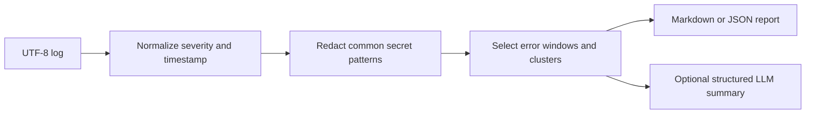

# TraceLens

### Find the incident inside the noise.


A read-only log investigation CLI. It preserves line references, selects error windows, groups repeated failures, and optionally asks an LLM to explain the evidence.

> **Portfolio release:** initial implementation. Runtime, dependencies, and model behavior have not been tested. The commands below describe intended usage, not verified results.

## What you can explore

| Capability | Implementation |
|---|---|
| Timeline | Original line numbers, ISO-like timestamps, and normalized severity |
| Context selection | Two lines before and after errors; bounded to 80 lines |
| Error clusters | Group repeated error text with numeric values normalized |
| Redaction | Common key/value secrets, authorization headers, URL credentials, and email patterns |
| AI analysis | Separate observations, hypotheses, and diagnostic suggestions |

## How it fits together



## Quick start

Use Python 3.11 or newer. Run from the repository root. Git is also required for CodeTrail.

```powershell
git clone https://github.com/TanjayaJason/TraceLens.git
cd TraceLens
python -m venv .venv
.\.venv\Scripts\Activate.ps1
pip install -e ".[ai]"
Copy-Item .env.example .env
```

Skip the copy if `.env` already exists. On macOS/Linux, activate with `source .venv/bin/activate` and copy with `cp .env.example .env`.

```powershell
tracelens examples/incident.log
tracelens examples/incident.log --json
```

## Optional AI mode

Fill `OPENAI_API_KEY` and `OPENAI_MODEL` in your local `.env`. Set `OPENAI_BASE_URL` only when using a compatible endpoint. The endpoint must support tool/function calling. Installing the AI extra does not enable model calls: opt in with `--ai` or the PageProof sidebar toggle.

```powershell
tracelens examples/incident.log --ai --question "Why did checkout fail?"
```

Provider calls use a 45-second timeout and no automatic retries. Invalid structured responses are rejected. No API keys are included in this repository.

## Limits you should know

UTF-8 text, at most 10 MB and 100,000 lines. Individual lines are truncated at 1,500 characters in reports. The first 80 selected context lines are used; later incidents may be omitted. Redaction is heuristic and does not guarantee removal of all secrets. Citation validation checks line existence, not the truth of a diagnosis. The CLI never executes proposed diagnostic steps.

User input is treated as evidence, never executable instructions. Model output remains advisory. Keep private documents, logs, datasets, repositories, and generated reports out of Git; `data/`, `reports/`, and `.env` are ignored.

## Repository guide

```text
src/tracelens/
  core.py          Domain logic and evidence handling
  cli.py           Command-line entry point
  support.py       Bounded input and optional provider boundary
docs/
  PRD.md           Product scope and acceptance goals
  DESIGN.md        Architecture and implementation decisions
  STATUS.md        Delivery and validation status
.agents/skills/tracelens/SKILL.md
AGENTS.md          Guidance for future coding work
.env.example       Empty configuration template
```

## Where this goes next

- Expand structured JSON and Nginx parsing.
- Add selectable incident windows and relevance ranking.
- Evaluate redaction coverage with synthetic secret patterns.

## Project notes

Read the [PRD](docs/PRD.md), [design](docs/DESIGN.md), and [delivery status](docs/STATUS.md) for scope and tradeoffs. This release intentionally has no evaluation results or benchmark claims. A license has not been selected; no broad reuse rights are implied.
